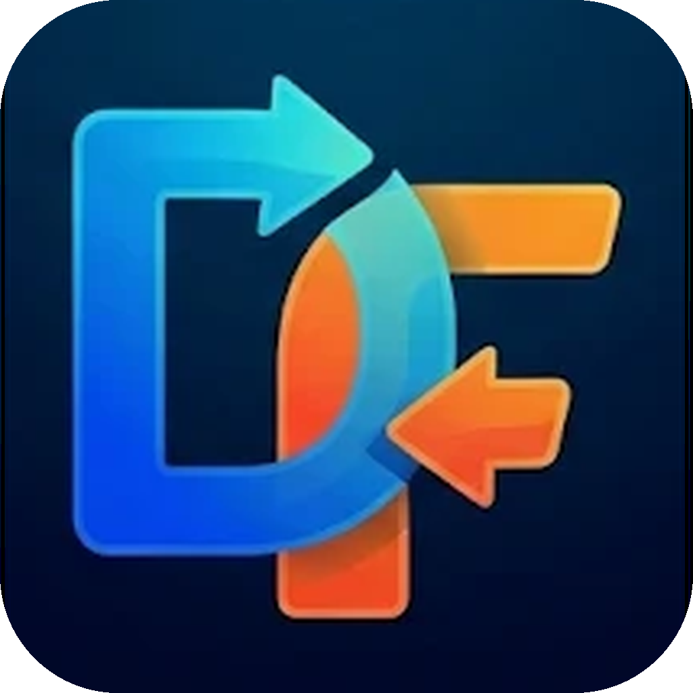
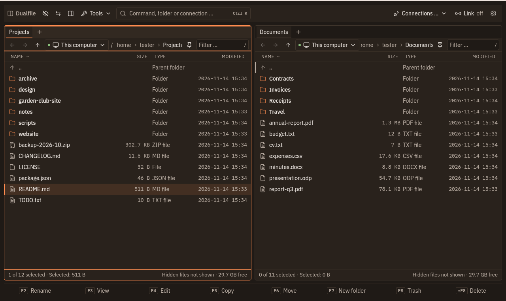
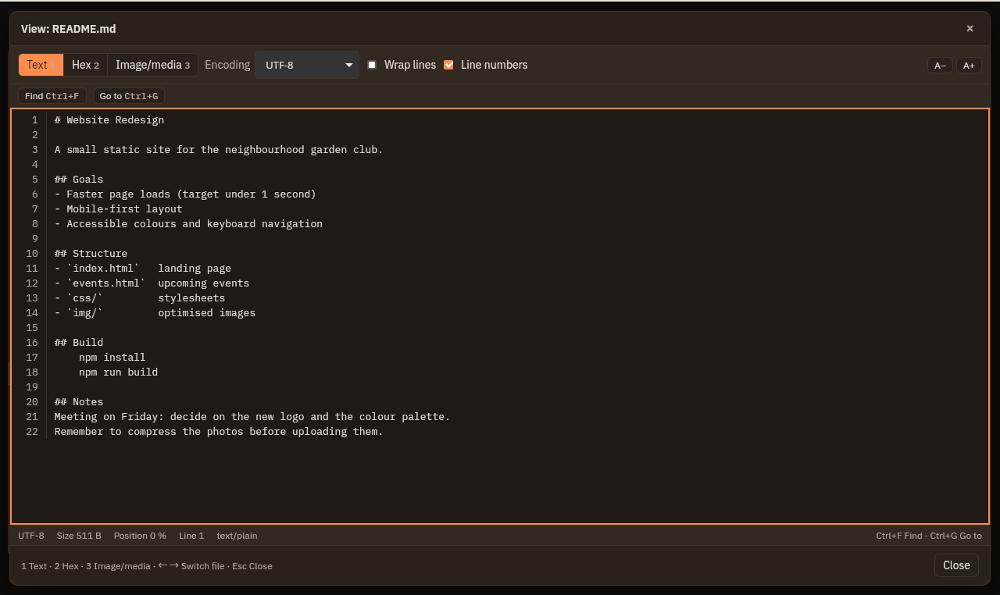
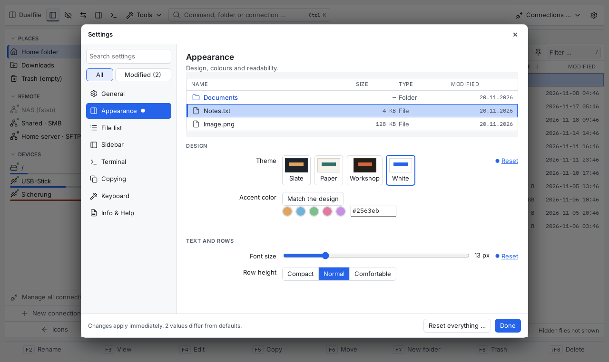

<p align="center"></p>

<h1 align="center">Dualfile</h1>

<p align="center"><strong>Two panes, side by side. Browse local folders, archives and remote servers, and move files between them.</strong></p>

<p align="center">
  <a href="https://github.com/Bexxs75/dualfile/actions/workflows/ci.yml"></a>
  <a href="https://github.com/Bexxs75/dualfile/releases/latest"></a>
  <a href="https://github.com/Bexxs75/dualfile/releases"></a>
  <a href="LICENSE"></a>
  
  
</p>

Dualfile is a two-pane file manager for Linux with tabs, keyboard controls and background file jobs. It combines a Rust core, a Tauri 2 desktop shell and a React/TypeScript interface, and the interface is available in English and German.

> **Development snapshot.** Dualfile is not yet a stable release. See [Status and roadmap](#status-and-roadmap) before relying on a feature in production.

## Screenshots

<table>
  <tr>
    <td align="center"><br><sub>The two-pane main window</sub></td>
  </tr>
  <tr>
    <td align="center"><br><sub>The internal file viewer</sub></td>
  </tr>
  <tr>
    <td align="center"><br><sub>The settings screen</sub></td>
  </tr>
</table>

## What it is for

- **Move files between a local folder and a server.** Keep a folder in one pane and an SFTP, FTP/FTPS or SMB location in the other; copy or move in background jobs with optional SHA-256 verification.
- **Open an archive like a folder.** Browse ZIP, 7Z and TAR (including GZ/BZ2/XZ) archives, preview files and extract only what you need. RAR is read through an external helper.
- **Compare and synchronize two folders.** Use directory comparison and synchronization in the two panes, and compare two text files.
- **Tidy up in bulk.** Batch rename with preview, duplicate-file and similar-image search, and disk-usage inspection.
- **Work from the keyboard.** Tabs, bookmarks, function-key shortcuts and a command palette (`Ctrl+K`); trash and permanent deletion are separate actions, with undo where supported.

## Features

- Two panes with tabs, bookmarks, filtering, hidden-file controls and keyboard navigation.
- Copy, move, rename and delete with background jobs, pause/resume, progress and configurable SHA-256 transfer verification. Trash and permanent deletion are separate actions.
- Undo and operation history where supported; not every operation is reversible.
- ZIP, 7Z and TAR archives (including GZ/BZ2/XZ); RAR read support through an external helper. Search and file previews.
- Native SFTP, FTP/FTPS and SMB connections, saved profiles and imports from Dolphin/GNOME system places.
- Command palette (`Ctrl+K`), batch rename with preview, directory comparison and synchronization, text comparison.
- Duplicate-file search, similar-image search and disk-usage inspection.
- Light/dark themes, accent colors, density settings and English/German interface text.
- Process-plugin interface with explicit permissions; not compatible with Total Commander DLLs.

## Download

[Download from GitHub Releases](https://github.com/Bexxs75/dualfile/releases/latest). The latest release is **v0.1.0**, a development snapshot.

| Format | Available |
|---|---|
| Linux x86_64 AppImage (`Dualfile-<version>-x86_64.AppImage`) | Yes |
| Linux arm64 AppImage (`Dualfile-<version>-aarch64.AppImage`, Raspberry Pi) | Yes |
| Linux x86_64 tar.gz (`Dualfile-<version>-x86_64.tar.gz`) | Yes |
| Linux arm64 tar.gz (`Dualfile-<version>-aarch64.tar.gz`) | Yes |

For an AppImage, make the downloaded file executable and run it. A tar.gz extracts to a `Dualfile-<version>-<arch>/` folder; start it with `./Dualfile-<version>-<arch>/AppRun`. Check the release notes and checksums first.

## Compatibility and requirements

Linux with a graphical desktop. KDE Plasma and GNOME integration includes importing system places; this is not a guarantee for every desktop/distribution combination. The Tauri shell uses GTK 3 and WebKitGTK 4.1. AppImage execution may require FUSE 2, or extraction on systems without FUSE. RAR browsing requires an installed `7z` or `unrar` helper. Persistent remote credentials use the Linux desktop keyring (Secret Service/KWallet).

Enable the notification-area icon in Settings → System (off by default). Minimizing hides the window in the tray; use its Open/Quit menu. If tray creation fails, Settings shows a hint and the window minimizes normally. GNOME may require an AppIndicator extension. Settings also lets you add or remove the user-local start-menu entry; the startup prompt appears at most three times. Windows and macOS are not supported targets here.

## Is it safe to install?

The source is available for inspection. The release workflow is configured to sign the final AppImage for updater verification; this does not establish that signing has run successfully. An AppImage is executable software, not a sandbox. Download only from a source you trust. The draft-release workflow generates `SHA256SUMS`:

```sh
sha256sum --check --ignore-missing SHA256SUMS
```

Run this in the directory containing the checksum file and downloaded assets. A matching checksum detects changes relative to that file; it does not prove publisher identity or absence of bugs. Keep backups when testing file operations. Report vulnerabilities through [SECURITY.md](SECURITY.md).

## Updates

Settings → Updates shows the installed version and offers a manual check with its result and time. The optional startup check runs once without blocking the app. An available update shows a banner with release notes, Update and Later; Later suppresses that version until a newer one arrives (a manual check shows it again). Installation requires an explicit click and no active file jobs. AppImage updates show progress, support cancellation before installation, and restart after installation. Other launch formats open the release page instead. The release workflow signs the final repacked AppImage and requires a signing key before generating `latest.json`. The interface and startup checks are connected; native installation and tray behavior still need live verification.

## Keyboard shortcuts

Defaults from [`src/state/keymap.ts`](src/state/keymap.ts); file-list shortcuts depend on focus. The palette shortcut is handled by `CommandPalette.tsx`.

| Key | Action |
|---|---|
| Tab | Switch pane |
| F2 / Shift+F6 | Rename |
| F3 / Ctrl+Q | Viewer / quick view |
| F5 / F6 | Copy / move |
| F7 | New folder |
| F8 / Delete | Move to trash |
| Shift+F8 / Shift+Delete | Permanent deletion dialog |
| Ctrl+T / Ctrl+W | New / close tab |
| Ctrl+Z | Undo |
| Ctrl+M | Batch rename |
| Ctrl+Shift+D | Compare directories |
| Alt+Up | Parent directory |
| Ctrl+K | Command palette |

## Documentation

- [Changelog](CHANGELOG.md), [contribution guide](CONTRIBUTING.md), [security policy](SECURITY.md).
- [Third-party license inventory](THIRD-PARTY-LICENSES.md) — complete (no UNKNOWN entries). Regenerate with `scripts/gen-third-party.py`; Rust licenses come from the local Cargo registry cache (populated by a build) or a `--vendor` mirror.

## Contributing

Bug reports and proposals are welcome in English through [GitHub Issues](https://github.com/Bexxs75/dualfile/issues). Read [CONTRIBUTING.md](CONTRIBUTING.md) and the [Code of Conduct](CODE_OF_CONDUCT.md). Remove private data from examples and screenshots.

## Status and roadmap

The original plan covers the core, viewer, batch rename, archives, comparison, remote connections and plugins. Implementations now exist for these areas, followed by background jobs, disk tools, system-place imports, native SMB and the command palette. The `0.1.0` version is a development baseline, not a claim of a published stable release.

Next release work includes validated packaging, complete license metadata and final screenshots. Native updater/tray verification remains outstanding. The new CI and draft-release workflows have not yet run.

## Tech stack

Rust workspaces (`dualfile-core`, `dualfile-remote`, `dualfile-plugin` and a separate Tauri shell), Tauri 2, React 19, TypeScript, Vite, Tailwind CSS and Lucide icons. Unit/component tests use Cargo and Vitest.

## Development

Use Node.js 24 (the locked Vitest requires at least 22.12 in its supported release lines), npm, Python 3.11+ for the license generator, and Rust with rustfmt/clippy. No fixed Rust version is declared yet; workflows currently use `stable`.

On Ubuntu 22.04, the workflow installs `build-essential`, `pkg-config`, `libwebkit2gtk-4.1-dev`, `libgtk-3-dev`, `libssl-dev`, `libxdo-dev`, `libayatana-appindicator3-dev`, `librsvg2-dev` and `patchelf`. AppImage packaging additionally uses `libfuse2`, `file`, `curl`, `desktop-file-utils` and an executable `appimagetool`.

```sh
npm ci
npm run dev                 # browser UI with mock backend
npm run tauri dev           # native application
npm run typecheck
npm test
npm run build
cargo fmt --check
cargo clippy --workspace -- -D warnings
cargo test --workspace
# Repeat Rust checks in src-tauri, which is a separate workspace.
python3 scripts/test_make_latest_json.py
python3 scripts/gen-third-party.py
# Set APPIMAGETOOL to your installed executable before running:
bash scripts/build-appimage.sh
```

The AppImage script writes to `dist-appimage/` by default and repacks Tauri's AppDir for Linux graphics compatibility. Any updater signature must be made **after** that final repack.

## Project structure

| Path | Purpose |
|---|---|
| `crates/dualfile-core/` | File operations, archives, search, comparison, undo and disk tools |
| `crates/dualfile-remote/` | Native remote protocols |
| `crates/dualfile-plugin/` | Process-plugin host |
| `src-tauri/` | Desktop shell, IPC and packaging |
| `src/` | React interface, state, themes and translations |
| `scripts/` | Packaging, updater manifest and license inventory |
| `.github/` | Issue/PR templates and CI/draft-release workflows |

## License

[MIT](LICENSE), copyright 2026 Dualfile contributors. Dependencies retain their own licenses; see [THIRD-PARTY-LICENSES.md](THIRD-PARTY-LICENSES.md).

## Support

Dualfile is free and open source. If it helps you, you can support development:

[](https://ko-fi.com/V7W12ALQE3)
